<div align="center">

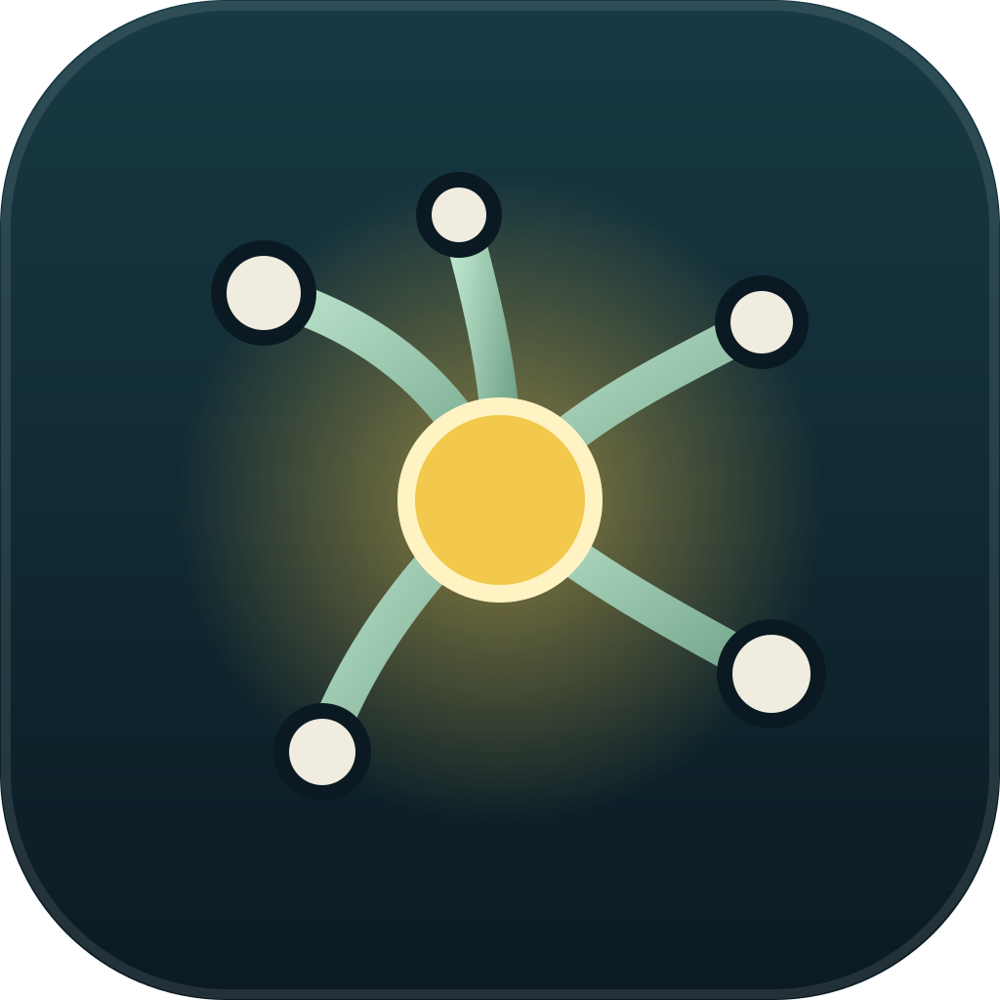

# Second Brain Studio

**Il tuo second brain e Claude Code, in una finestra sola.**
Appunti in Markdown che Claude tiene aggiornati, il vero Claude Code in linguette accanto,
e tutti i tuoi PC allineati tramite il tuo repository privato su GitHub.

[](https://github.com/Axelina23/second-brain-studio/releases/latest)
[](../app/requirements.txt)
[](../LICENSE.md)
[](#funzioni)

[Funzioni](#funzioni) · [Come funziona](#come-funziona) · [Installazione](#installazione) · [Domande](#domande-frequenti) · [Contribuire](#contribuire) · [🇬🇧 English](../README.md)

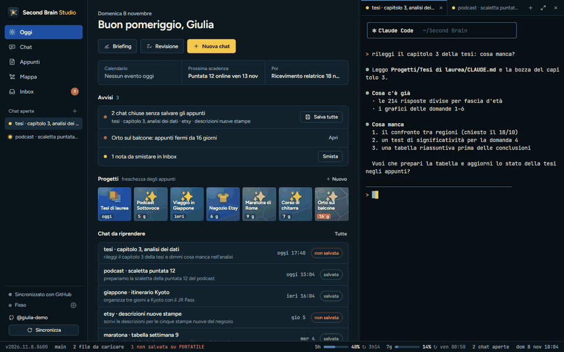

<sub>Tutte le immagini usano dati inventati: Giulia, la sua tesi, il suo podcast e il suo orto sul balcone non esistono.</sub>

</div>

## Perché

Claude Code ricorda benissimo le cose **se gli dai un posto dove ricordarle**: una cartella di appunti
con le tue regole, i tuoi progetti e il registro di quello che è successo. Second Brain Studio è la casa di quella cartella.

- Apri l'app e vedi **cosa è cambiato, cosa è fermo e quali chat non hai salvato**.
- Parli con Claude nel **vero Claude Code** (il tuo piano, i tuoi hook, i tuoi server MCP), non in un'imitazione.
- Quando una chat finisce, Claude **aggiorna gli appunti da solo**: registro, stato dei progetti, indice.
- Tutto è fatto di **file normali** sul tuo disco, con la cronologia di git e una copia in un **repository privato su GitHub**.

## Funzioni

<div align="center">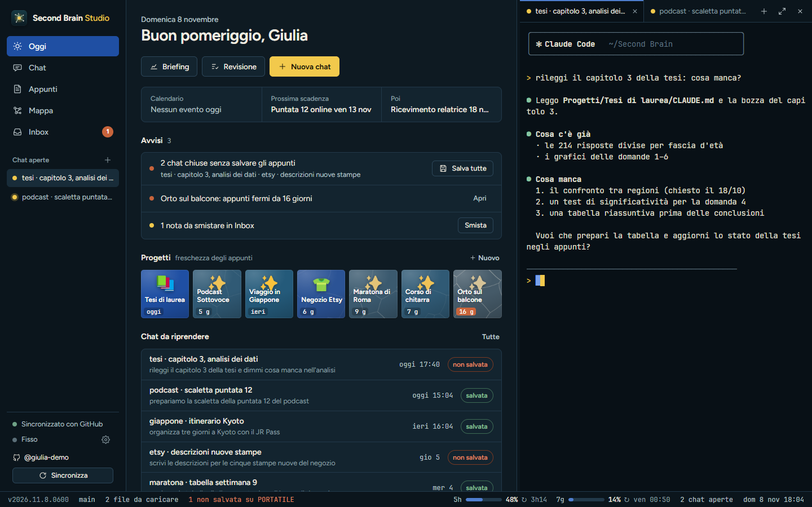</div>

<table>
<tr>
<td width="50%">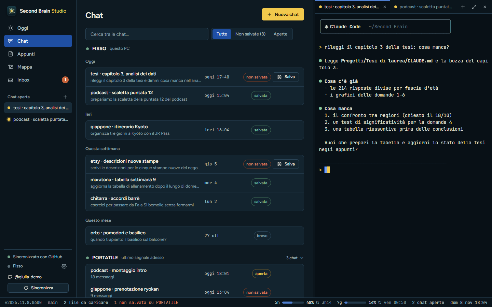</td>
<td width="50%">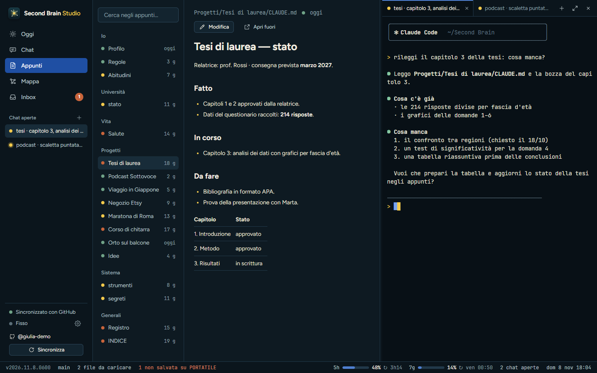</td>
</tr>
<tr>
<td><b>Ogni chat, su ogni PC.</b> Le chat sono divise per giorno, con parole chiave e stato del salvataggio. Ci sono
anche quelle degli altri PC, in tempo quasi reale e in sola lettura: vedi subito se ne hai lasciata una aperta sul portatile.</td>
<td><b>Appunti che si leggono.</b> Markdown impaginato bene, un pallino di freschezza per ogni file, ricerca nel testo,
piccole modifiche al volo. Le riscritture grandi le fa Claude.</td>
</tr>
<tr>
<td>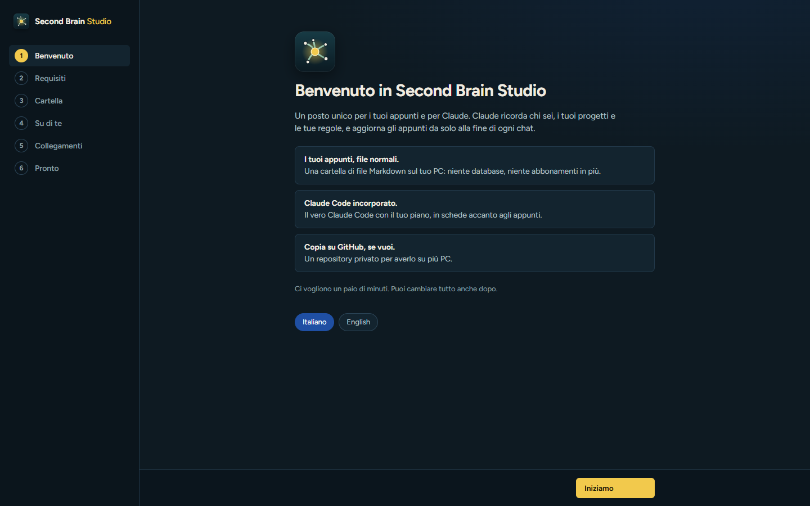</td>
<td>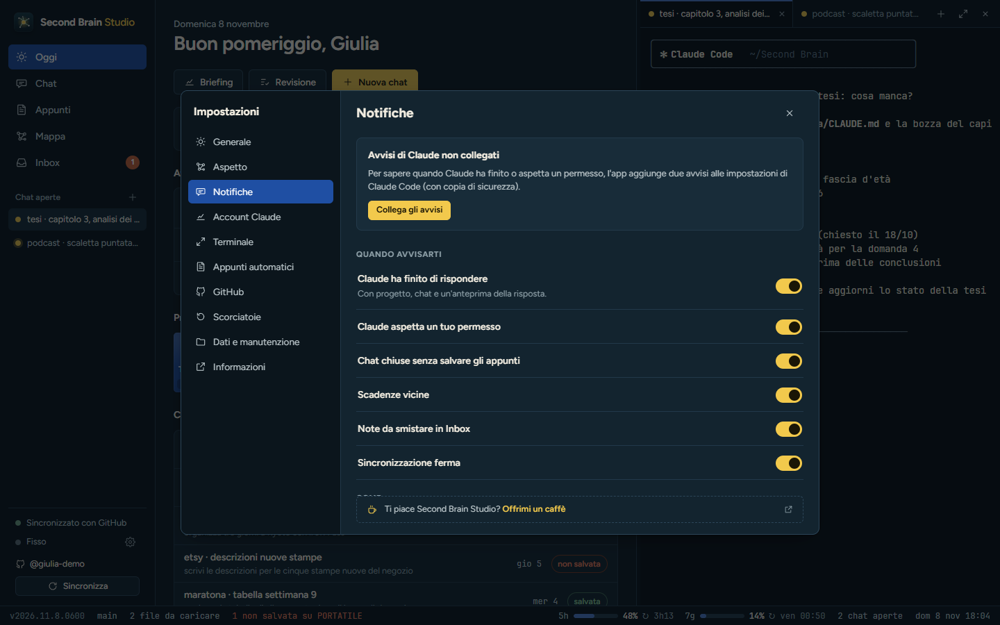</td>
</tr>
<tr>
<td><b>Pronto in due minuti.</b> Il primo avvio crea la cartella, fa qualche domanda (le aree della tua vita,
lo stile delle risposte, le regole che Claude deve seguire) e scrive le regole e l'indice che Claude legge in ogni chat.</td>
<td><b>Impostazioni per tutto.</b> Tema, colore, notifiche ("Claude ha finito", "Claude aspetta un tuo permesso"),
orari di silenzio e silenzio nei giochi a schermo intero, carattere del terminale, appunti automatici, sincronizzazione, aggiornamenti.</td>
</tr>
</table>

### Otto modi di guardare il tuo second brain

Colori per area o per freschezza: gli appunti fermi sbiadiscono come vecchie maioliche.

<table>
<tr>
<td width="50%">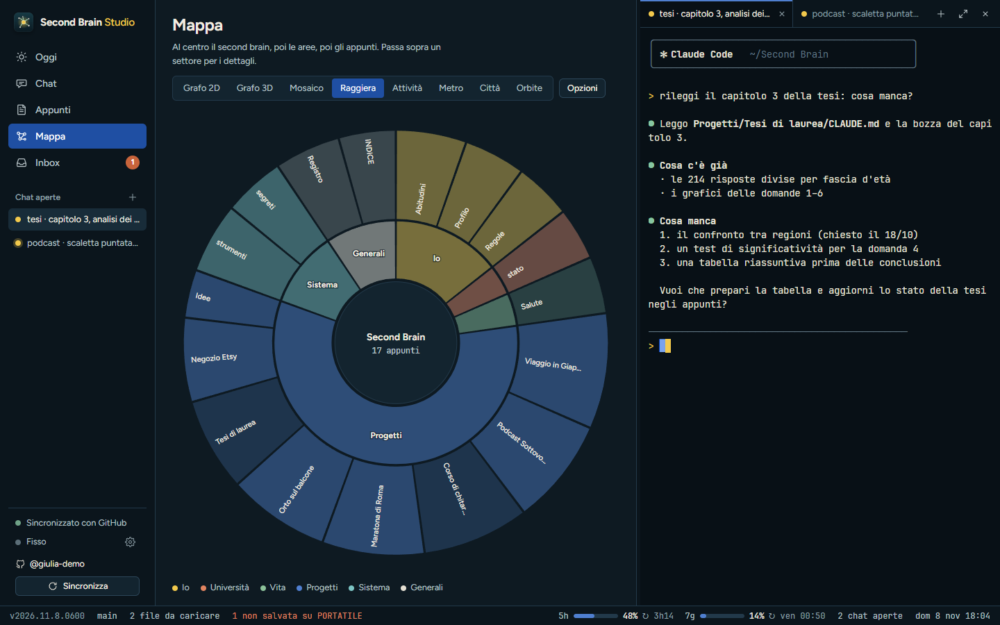<br><b>Raggiera</b>: le aree, poi gli appunti</td>
<td width="50%">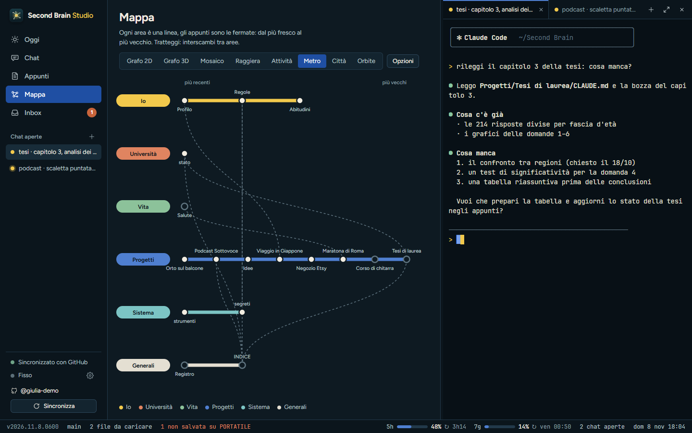<br><b>Metro</b>: una linea per area, dal più fresco al più vecchio</td>
</tr>
<tr>
<td>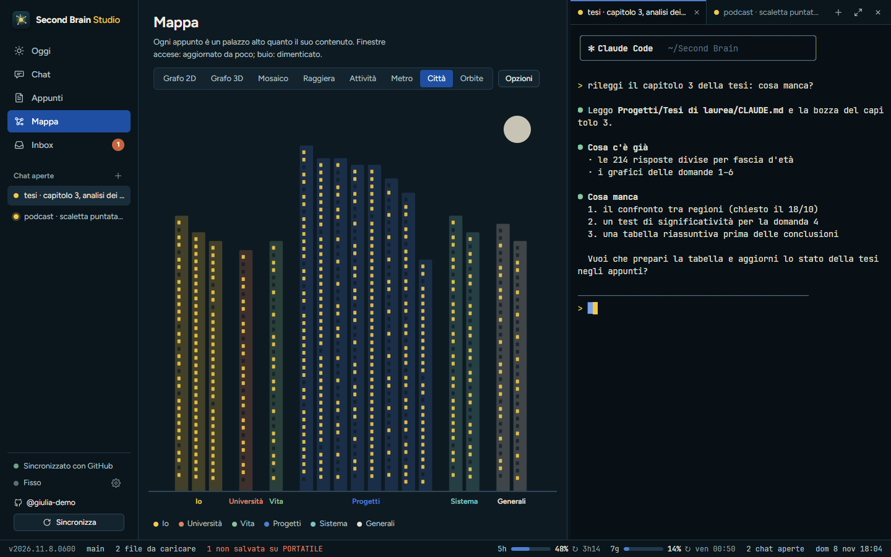<br><b>Città</b>: i palazzi alti contengono di più, le finestre buie sono appunti dimenticati</td>
<td>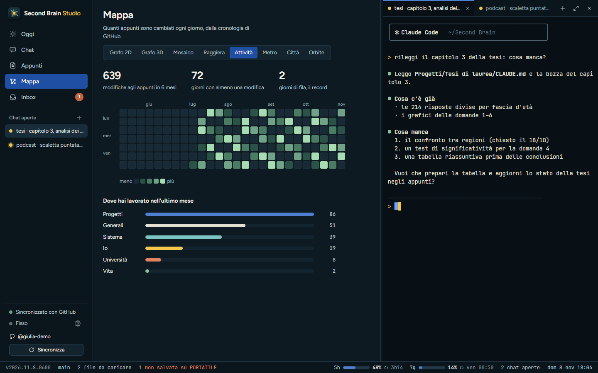<br><b>Attività</b>: cosa è cambiato ogni giorno, dalla cronologia di git</td>
</tr>
</table>

<details>
<summary>Le altre quattro viste: grafo 2D, grafo 3D, mosaico, orbite</summary>
<br>
<table>
<tr>
<td width="50%">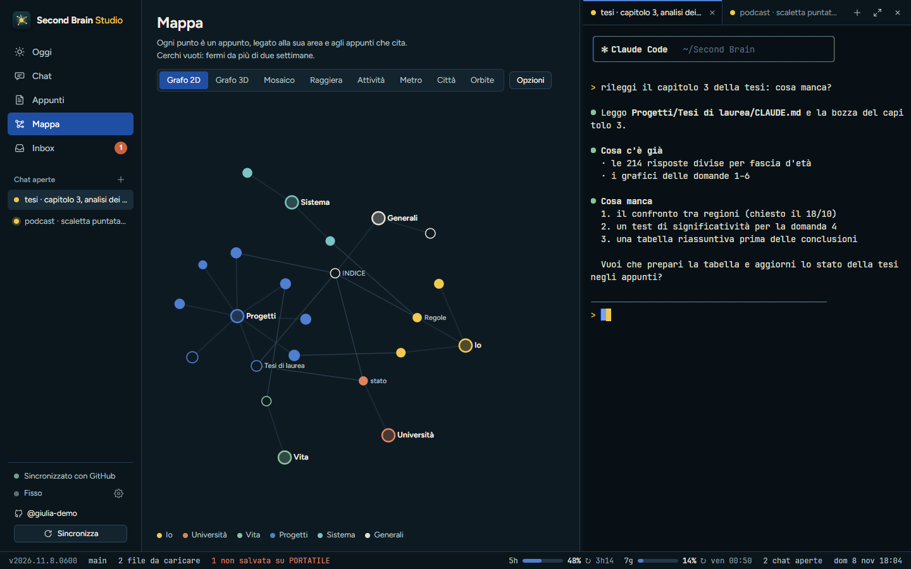<br><b>Grafo 2D</b>: ogni appunto legato alla sua area e agli appunti che cita</td>
<td width="50%">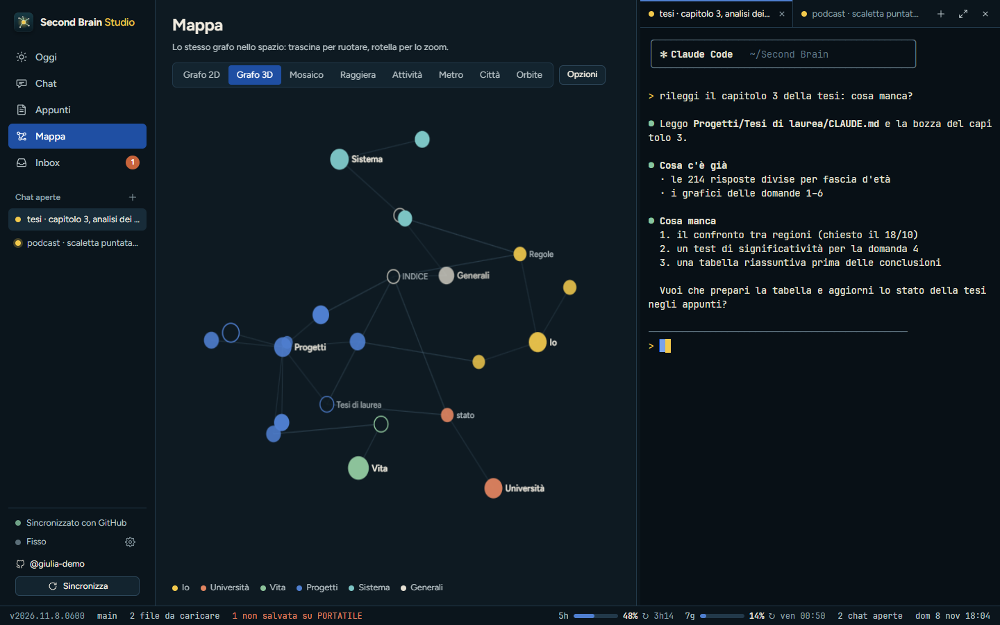<br><b>Grafo 3D</b>: lo stesso, nello spazio</td>
</tr>
<tr>
<td>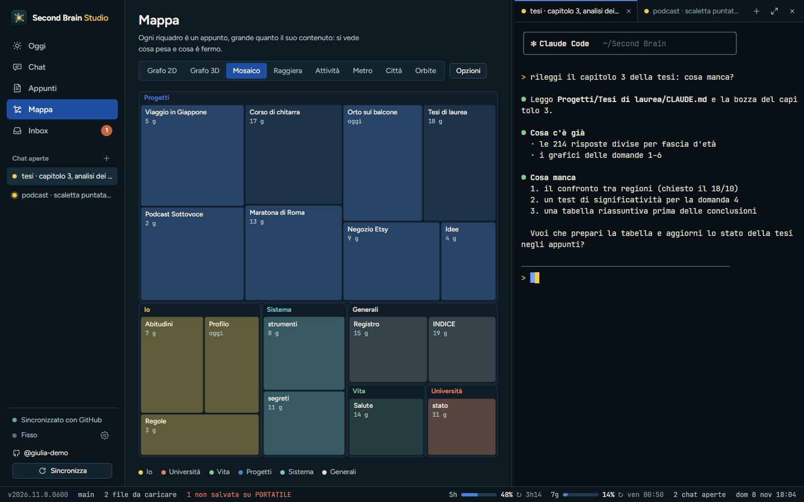<br><b>Mosaico</b>: ogni riquadro grande quanto il suo appunto</td>
<td>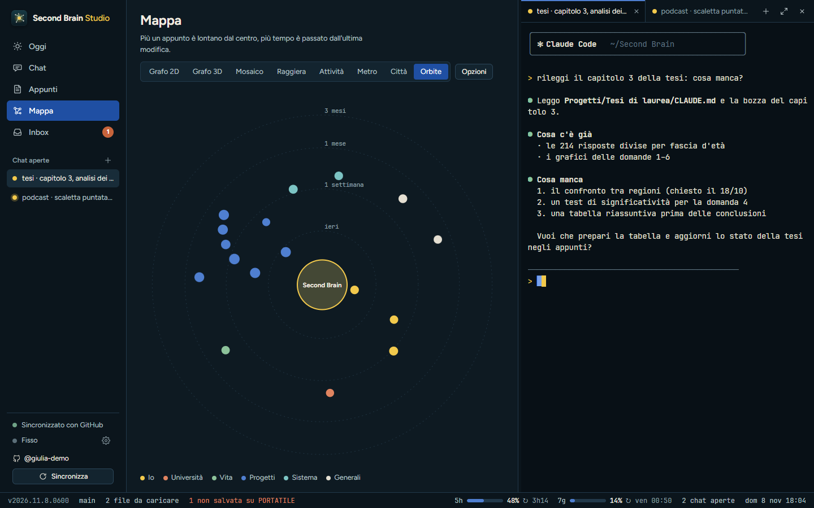<br><b>Orbite</b>: più è lontano dal centro, più tempo è passato dall'ultima modifica</td>
</tr>
</table>
</details>

### Cosa c'è dentro

| | |
|---|---|
| 🖥️ **Il vero Claude Code** | `claude.exe` in una vera console (xterm.js + ConPTY): colori, Maiusc+Invio, comandi con la barra, riga di stato. |
| 📝 **Appunti automatici** | Uno hook `SessionEnd` riassume la conversazione e fa aggiornare a Claude registro e file di stato, in background. Chiudendo una linguetta Claude esce da solo, così non si perde niente. |
| 🔔 **Notifiche cliccabili** | Notifiche di Windows con progetto, chat e anteprima della risposta. Un clic e si apre la linguetta giusta. |
| 🔄 **GitHub integrato** | Accesso con codice dal browser (l'app non vede mai la tua password), creazione del repository privato, sincronizzazione con un clic, conflitti affidati a Claude. |
| 💻 **Chat di tutti i PC** | Ogni PC pubblica un piccolo riepilogo delle sue chat (parole chiave, orari, stato, mai i messaggi) su un ramo del tuo repository. |
| ⬆️ **Si aggiorna da sola** | Le nuove versioni si scaricano e si controllano (dimensione + SHA-256) in background; un clic le installa e riapre le tue chat. |
| 📊 **Consumo del piano** | L'uso di Claude nelle 5 ore e nella settimana, nella barra di stato. |
| 🌍 **Italiano e inglese** | La lingua si cambia in Impostazioni → Generale. |
| 🌗 **Scuro e chiaro** | Tavolozza "Chiostro di Santa Chiara", come le maioliche: cobalto, limone, verderame e terracotta. |

<div align="center">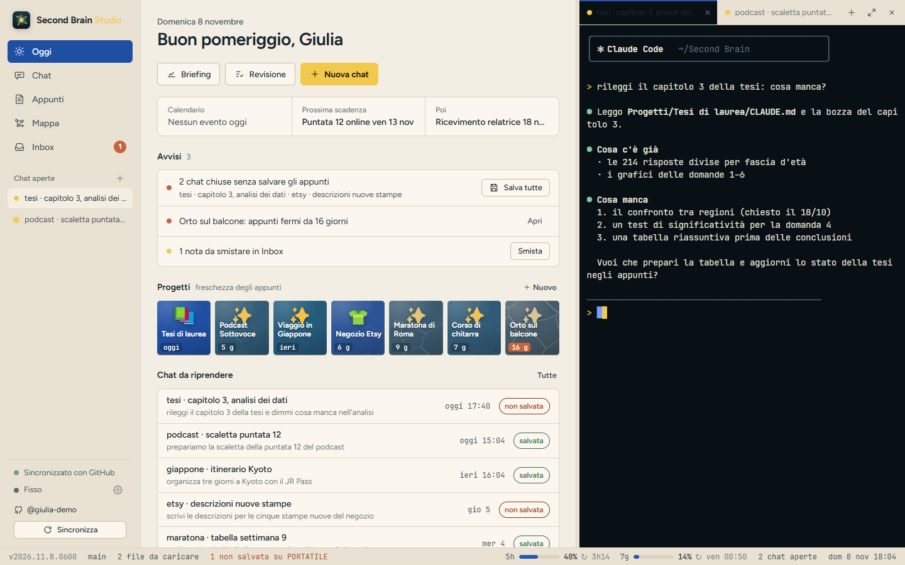</div>

## Come funziona

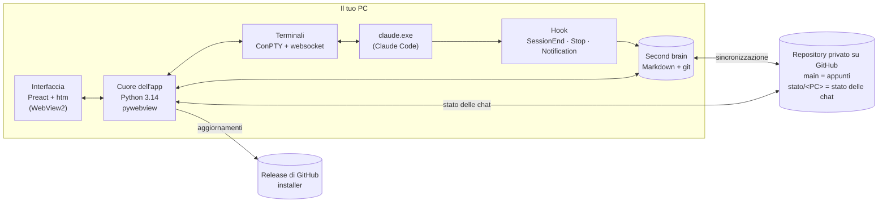

### La vita di una chat

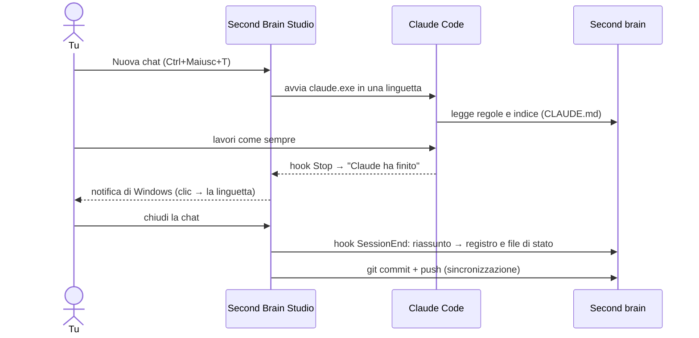

### Le chat degli altri PC

Nessun programma in più e nessun server nostro: passa tutto dal repository privato che hai già.

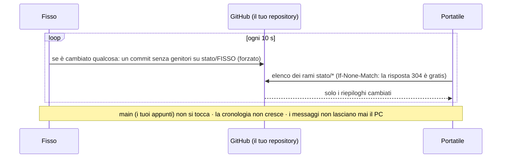

## Installazione

1. **Serve**: Windows 10 o 11, [Claude Code](https://docs.claude.com/it/docs/claude-code/setup) con l'accesso fatto, [Git per Windows](https://git-scm.com/download/win).
2. **Scarica** `Second Brain Studio Setup <versione>.exe` dall'[ultima release](https://github.com/Axelina23/second-brain-studio/releases/latest) e avvialo.
   Si installa solo per il tuo utente: niente permessi di amministratore.
3. **"Windows ha protetto il PC"?** L'installer non è ancora firmato, quindi SmartScreen avvisa.
   Clicca **Ulteriori informazioni** e poi **Esegui comunque**. Se vuoi controllarlo, GitHub mostra lo SHA-256 di ogni file della release.
4. **Primo avvio**: crei un second brain nuovo, usi una cartella che hai già o scarichi il tuo da GitHub.

Poi l'app si aggiorna da sola. Le versioni di prova (segnate *Pre-release*) arrivano solo se attivi
*Anche le versioni di prova* in Impostazioni → Generale → Aggiornamenti.

### Compilarla dal codice

```powershell
git clone https://github.com/Axelina23/second-brain-studio
cd second-brain-studio
py -3.14 -m pip install --user -r app\requirements.txt
python -m pytest -q                             # test
python app\main.py --debug                      # avvio dal codice
winget install JRSoftware.InnoSetup             # solo per creare l'installer
powershell -ExecutionPolicy Bypass -File app\build.ps1
```

Interfaccia senza Python: `python -m http.server 8765 -d app\web`, poi apri `http://127.0.0.1:8765/prova.html`
(`?demo` per le chat aperte, `?en` per l'inglese, `?primo` per il primo avvio). Lì i dati sono tutti inventati.
Le immagini e la GIF di questa pagina escono dalla stessa pagina: `docs\immagini\screenshot.ps1`.

## Com'è fatto il repository

```
app/            l'app: finestra, terminali, GitHub, aggiornamenti, notifiche, interfaccia (web/)
  hooks/        hook PowerShell installati per Claude Code (fine sessione, avvisi, sincronizzazione)
  web/          interfaccia Preact + htm senza compilazione; vendor/ contiene xterm.js, marked, DOMPurify
motore/         il motore: sessioni, parole chiave, appunti, freschezza, stato della sync (Python puro, con test)
docs/           immagini e note per chi la mantiene
```

## Domande frequenti

**Usa le API o il mio abbonamento a Claude?**
Avvia il Claude Code che hai già, con l'accesso che usa lui: abbonamento, chiave API, Bedrock o Vertex.

**Dove stanno i miei appunti?**
In una cartella normale che scegli tu, come file Markdown. Se disinstalli l'app restano dove sono.

**Com'è fatta la cartella?**
Creata in italiano: `INDICE.md` e `CLAUDE.md` in cima, poi `Io/` (regole e profilo), una cartella per ogni area che hai
scelto (`Lavoro/`, `Famiglia/`…), `Progetti/<Nome>/CLAUDE.md`, `Archivio/Registro.md`, `Sistema/` e `Inbox/`.
In inglese la stessa struttura ha nomi inglesi (`INDEX.md`, `Me/`, `Projects/`…). La lingua si sceglie nella prima schermata
e resta legata a quel second brain anche se poi cambi la lingua dell'app.

**Cosa va esattamente su GitHub?**
I tuoi appunti (nel tuo repository privato, come qualsiasi repository git) e, se la vista multi-PC è attiva, un piccolo
JSON per PC con parole chiave, orari e stato delle chat. Mai il contenuto delle conversazioni.

**Perché Windows mi avvisa quando apro l'installer?**
I certificati per firmare il codice si pagano ogni anno e questo è un progetto gratuito, quindi l'installer non è firmato.
SmartScreen avvisa per i file non firmati che pochi hanno scaricato finora. Se preferisci non fidarti di un eseguibile,
il codice e lo script per compilarlo sono tutti qui.

**E il Mac?**
È in programma. Il motore funziona ovunque; le parti legate a Windows sono il terminale e l'installer.

## Contribuire

Segnalazioni, idee e piccole correzioni sono benvenute: leggi [CONTRIBUTING.md](../CONTRIBUTING.md) (in inglese; nelle issue va bene anche l'italiano).
Le domande vanno nelle [Discussions](https://github.com/Axelina23/second-brain-studio/discussions).
Cosa cambia in ogni versione: [CHANGELOG.md](../CHANGELOG.md).

## Sostieni il progetto

Second Brain Studio è gratis e lo sviluppo nel tempo libero. Se ti fa risparmiare tempo, un caffè aiuta molto.

[](https://ko-fi.com/N0Z52A98V1)

## Licenza

[PolyForm Noncommercial 1.0.0](../LICENSE.md): gratis da usare, modificare e condividere per qualsiasi scopo non commerciale.
Nessuno può venderla. Icone degli emblemi: Microsoft Fluent Emoji (MIT). Terminale: xterm.js. Interfaccia: Preact.
